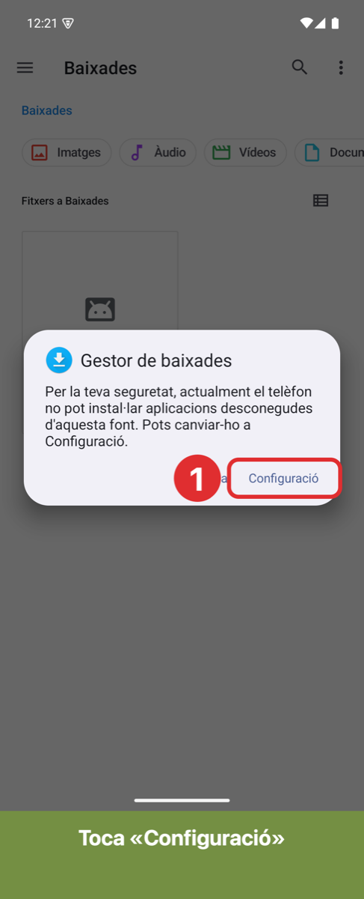
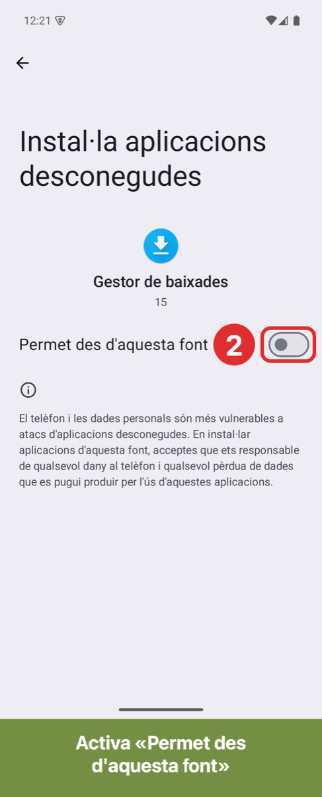
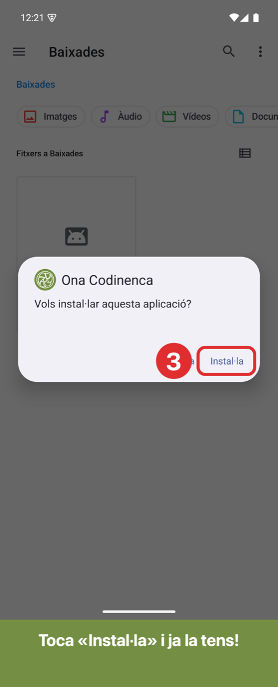

# App d'Ona Codinenca · versió de prova (Android)

App de la ràdio municipal de Sant Feliu de Codines (107.2 FM): directe, graella, podcasts, notícies amb àudios, Lliga Tu Jugues, vídeos i avisos.

Aquí només hi ha les **versions de prova** per instal·lar. El codi és en un repositori privat.

## ⬇️ Baixa la darrera versió

**[OnaCodinenca-beta.apk](https://github.com/onacodinenca/app-beta/releases/latest/download/OnaCodinenca-beta.apk)**

Aquest enllaç baixa sempre la darrera versió. Llista de versions i novetats: [Releases](https://github.com/onacodinenca/app-beta/releases).

## Com instal·lar-la (només Android)

1. Des del mòbil, obre l'enllaç de dalt i baixa el fitxer.
2. Obre el fitxer baixat. La primera vegada el mòbil dirà que no pot instal·lar aplicacions d'aquesta font: toca **Configuració**.
3. Activa **Permet des d'aquesta font** i torna enrere.
4. Toca **Instal·la**.

| 1 | 2 | 3 |
|---|---|---|
|  |  |  |

## Actualitzacions

A partir de la versió 0.3.2, l'app avisa sola quan hi ha una versió nova: toca **Baixa-la**, obre el fitxer i toca **Actualitza**. No es perd res.

Comentaris i errors: radio@onacodinenca.cat
